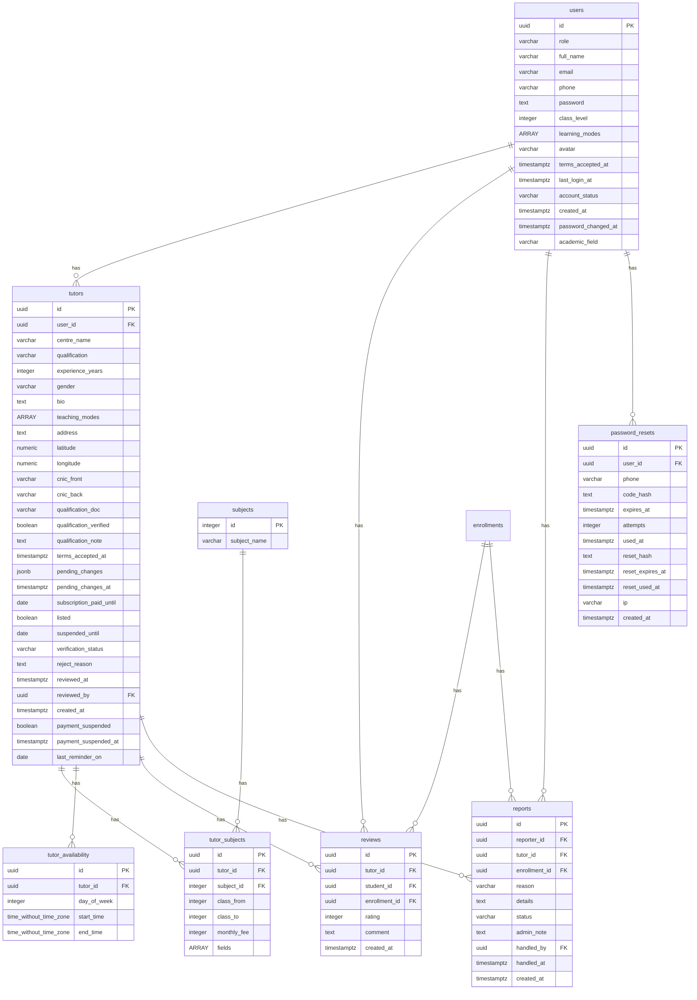
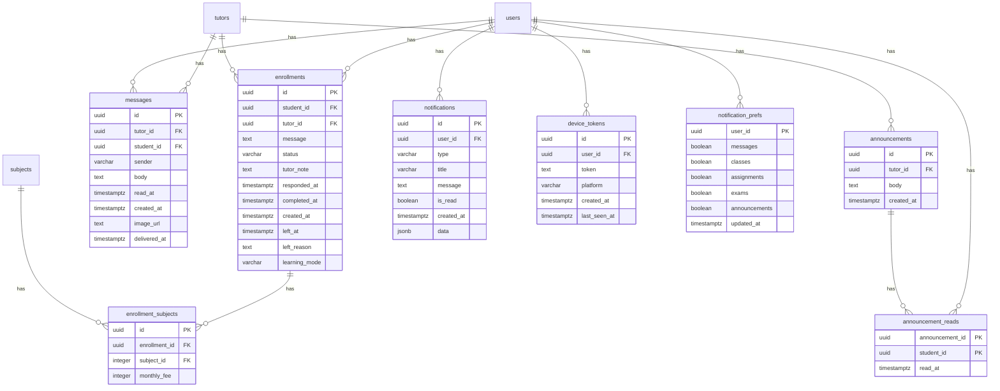
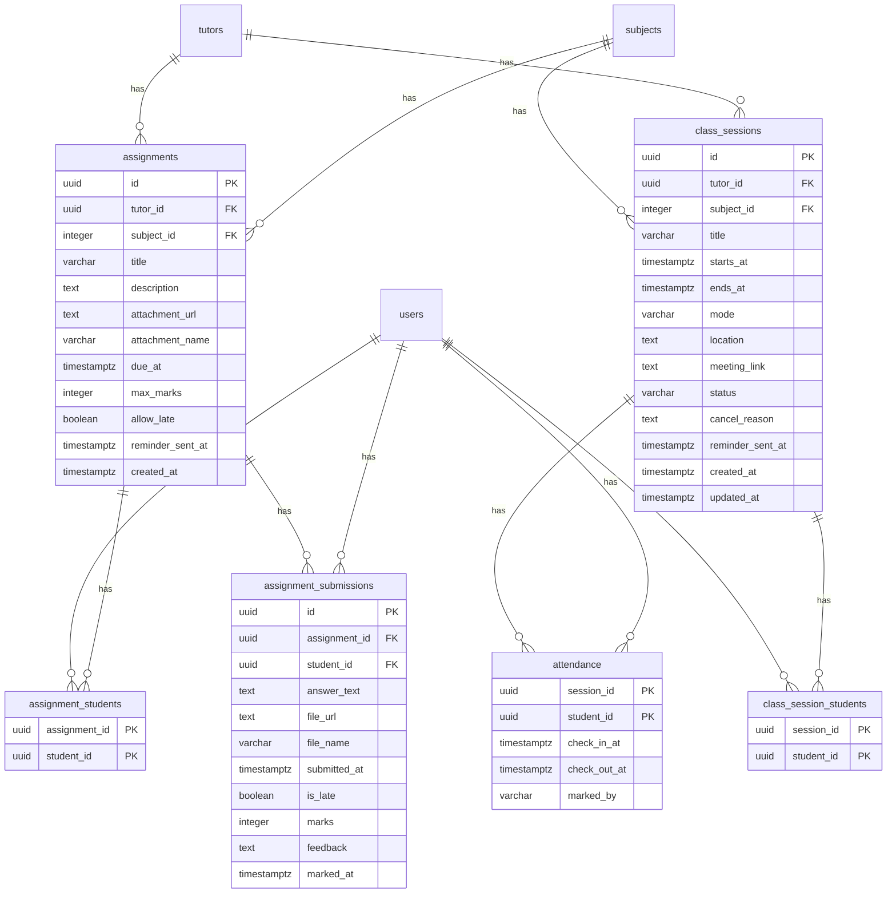
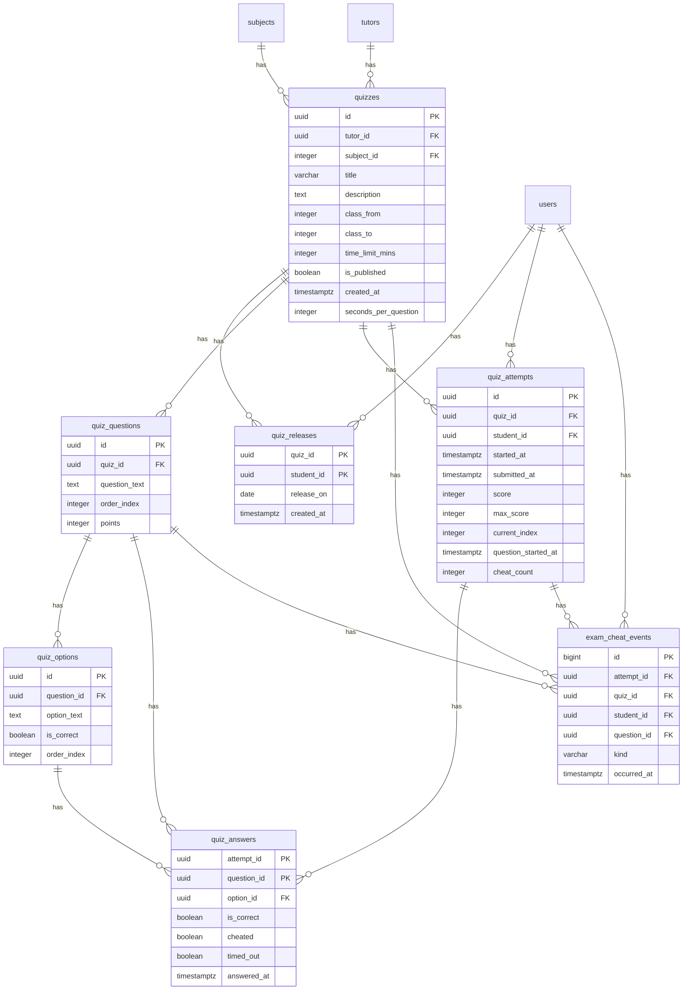
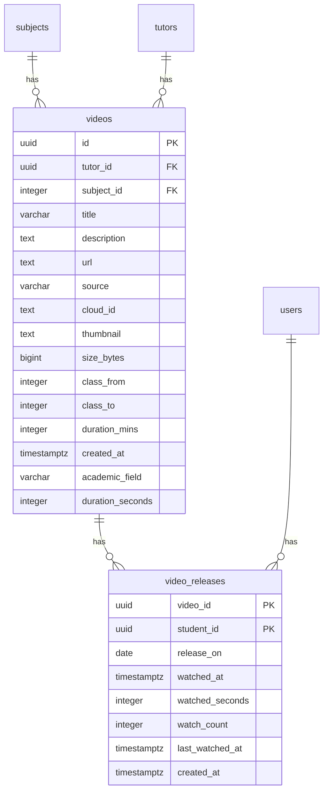
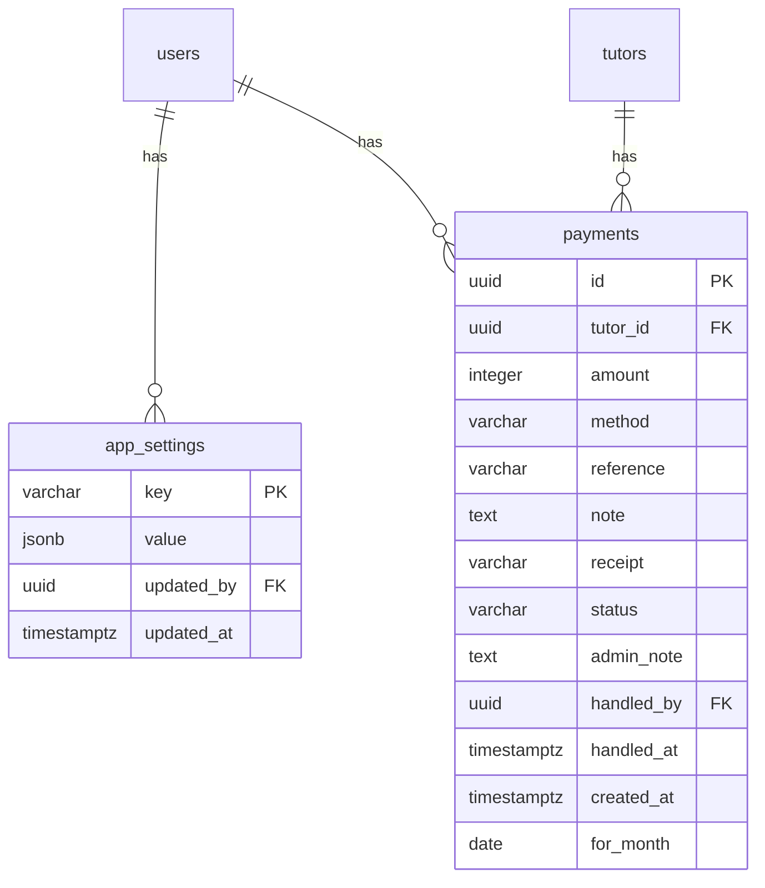
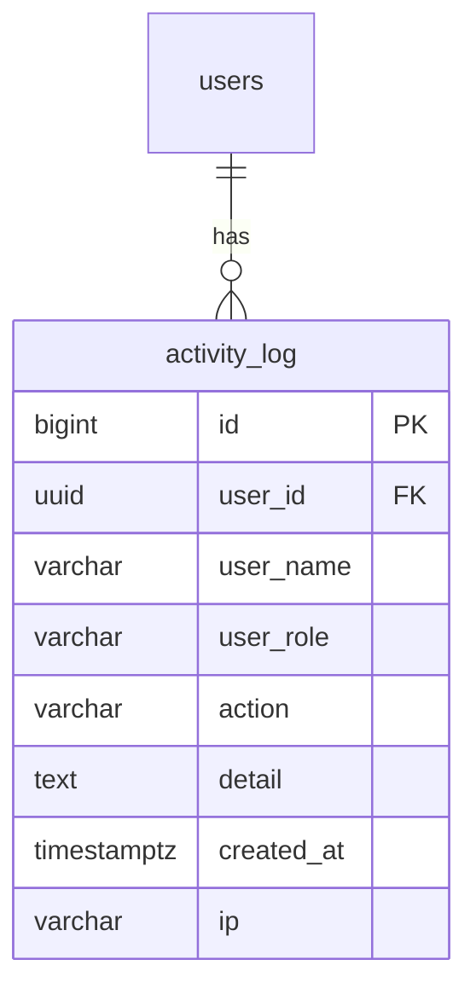
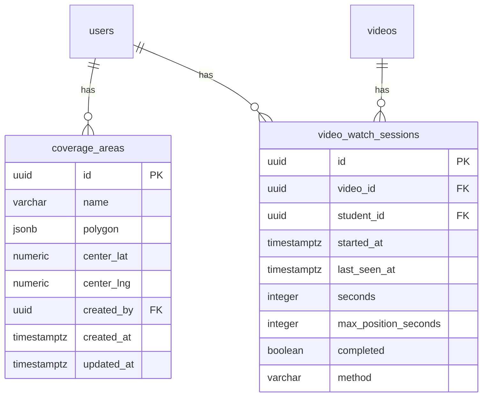

# Entity-relationship diagram

_Generated from the live database by `node scripts/er.mjs` — 36 tables._

Each box lists every column. `PK` primary key, `FK` foreign key.

## Accounts and tutors

## Enrollment and chat

## Classes and assignments

## Exams

## Videos

## Payments and settings

## Audit

## Other

